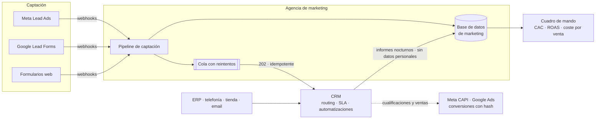

<picture>
  <source media="(prefers-color-scheme: dark)" srcset="assets/banner-dark.svg">
  
</picture>

  
  
  
  

## 👋 Sobre mí

Soy **analista de datos y de automatizaciones**, y desarrollo software apoyándome en **IA**. Convierto los datos de una empresa en dashboards y decisiones, y automatizo lo que mueve **leads, clientes y ventas**: CRMs a medida, APIs e integraciones entre sistemas y plataformas de marketing.

- 🔭 **Ahora mismo:** construyendo un CRM multipaís a medida, integrado con el ERP, las plataformas de anuncios y la base de datos de marketing.
- 🎓 **Estudiando** el Bachelor *International Business Management – Data Science, Protection & Security* en **Thomas More** (Bélgica): Data Science, Machine Learning & Forecasting, DevOps y Data as a Service.
- 🧠 **Me interesa:** análisis de datos, calidad de datos, atribución de marketing, forecasting y llevar la IA a casos de uso reales.
- 🔒 **La mayor parte de mi trabajo vive en repositorios privados de empresa.** Más abajo explico qué hice y cómo, sin enseñar código ni datos.

## 🛠️ Stack

  

  
  
  
  
  
  
  
  
  
  
  
  
  

## 🚀 Trabajo destacado

> [!NOTE]
> Son proyectos reales en producción dentro de una empresa europea de tecnología IoT. Por confidencialidad no publico código, datos ni nombres. Aquí cuento el problema, la arquitectura y las decisiones.

### 🧩 CRM multipaís a medida con leads en tiempo real

**El problema:** los leads llegaban de muchos sitios (Meta Lead Ads, formularios de Google, la web, WhatsApp) para cinco mercados europeos. El histórico estaba en un CRM SaaS, las ventas en el ERP, y nadie podía responder a la pregunta clave: *¿qué campaña trae clientes que pagan?*

**Lo que hice:** construí el CRM y diseñé cómo se integra con todo lo demás: el ERP, las plataformas de anuncios y la base de datos de marketing que monta una agencia externa.

- ⚡ **Leads al momento.** Llegan por webhook y el CRM los recibe en segundos. Endpoint **idempotente** (el mismo lead enviado diez veces es un solo lead), respuesta `202` inmediata con procesado en segundo plano y *rate limiting*. Definí el contrato de entrega con reintentos y cola, así que si el CRM se cae no se pierde ningún lead.
- 🧹 **Migración y limpieza de 6 años de histórico** desde HubSpot: decenas de miles de contactos y cientos de miles de llamadas, notas y tareas. Casé cada registro con los clientes del ERP por orden de fiabilidad (vínculo directo → email/teléfono normalizados → id de la app), separé el ruido (spam, contactos vacíos, llamadas sin identidad) dejando trazado el motivo de cada descarte, y reconstruí el historial de etapas de cada lead.
- 🔗 **Deduplicación automática** con reglas de negocio: se fusionan las fichas que son la misma persona, pero nunca dos clientes distintos del ERP (por ejemplo, una finca y su cooperativa); esos se relacionan.
- 🧭 **Operación comercial:** asignación de leads por país, SLA de 15 minutos por lead, automatizaciones por evento y registro de consentimientos.
- 📊 **Medición de verdad:** el CRM entrega cada noche sus informes a la base de marketing, sin datos personales (solo identificadores internos). Con eso el análisis pasa de "coste por lead" a **coste por venta, CAC y ROAS por campaña**. Además hay una conciliación diaria lead a lead entre las dos bases.
- 🔁 **Bucle cerrado con Meta y Google:** las cualificaciones y las ventas vuelven a las plataformas (Conversions API y conversiones mejoradas). Los datos de usuario van con hash SHA-256 y un `event_id` estable para deduplicar. Así las campañas optimizan hacia quien compra, no hacia quien solo rellena un formulario.
- 🛡️ **RGPD y seguridad desde el diseño:** datos en la UE, nada de datos personales fuera del CRM, accesos con el mínimo privilegio y rotación de credenciales.

<b>Ver arquitectura</b>

**Decisiones de diseño**

| Decisión | Por qué |
| --- | --- |
| Webhooks y no sondeo para los leads | El SLA del comercial empieza al captar el lead: cada minuto de retraso se lo quita a él |
| Idempotencia por `origen + id externo` | Hace seguros los reintentos y permite migrar de un flujo a otro en paralelo sin duplicar leads |
| Cola con reintentos entre la agencia y el CRM | Desacopla los dos lados: si uno cae, el otro sigue funcionando y la cola recupera lo pendiente |
| Volcado sin datos personales | El análisis cruza y cuenta con identificadores internos, sin mover PII fuera del CRM |
| Un solo emisor de conversiones por plataforma | Dos emisores del mismo evento inflan las conversiones y ensucian la optimización |
| Corte por fases con conciliación | Cada fuente antigua se apaga solo tras dos semanas sin diferencias |

Python · APIs REST y webhooks · Meta Marketing API · Google Ads API · n8n · migración de datos · RGPD

---

### 🔎 Buscador de clientes multi-fuente con lenguaje natural

Un servicio HTTP independiente que encuentra clientes **combinando todas las fuentes de datos** de la empresa (ERP y geolocalización de dispositivos IoT) y explica **por qué** ha salido cada resultado.

- Un único endpoint con condiciones combinables (`all` / `any` / `not`) sobre cualquier campo de **30 tablas del ERP**: clientes, pedidos, renovaciones, impagos, incidencias… y también sobre zonas geográficas.
- **Preguntas en lenguaje natural, en cualquier idioma,** que un LLM traduce a esas mismas condiciones. La IA **nunca ve datos de clientes**: solo elige condiciones de un catálogo.
- Arquitectura de **plugins**: añadir una fuente nueva es un fichero, y aparece sola en la API, en el catálogo y en la IA, sin tocar el núcleo.
- Consulta las fuentes **en vivo**, sin copiar el ERP a ningún sitio, y en **solo lectura** por diseño.

Python · FastAPI · SQLAlchemy · PostgreSQL · OpenAI API · Docker

---

### 📊 Análisis de datos y dashboards de negocio

El análisis y los cuadros de mando que usa dirección para ventas y marketing.

- Descarga en paralelo **19 tablas** de la API del ERP con **caché SQLite** en disco: el arranque es instantáneo y los datos se refrescan en segundo plano cada pocos minutos.
- Pasé la lógica de negocio de **Power BI (DAX) a pandas** y la validé importe a importe con una vista de detalle factura → producto.
- Ventas por canal, país y tipo de cliente, producto, unidades y PVP medio, y comparativas anuales y frente a presupuesto.

Python · Streamlit · pandas · Plotly · SQLite · Docker

<!-- PROJECTS:START -->
## 📂 Proyectos públicos y de formación

<table>
<tr><td width="50%" valign="top"><a href="https://github.com/thomas-more-devops/taskflow-group-3-IADI3"><b>taskflow-group-3-IADI3</b></a> TaskFlow · proyecto de DevOps en equipo: flujo Git con ramas, pull requests, issues y revisión de código.   actualizado 10 oct 2026</td><td width="50%" valign="top"><a href="https://github.com/Rodrigo160701/f1-portfolio"><b>f1-portfolio</b></a> · <a href="https://rodrigo160701.github.io/f1-portfolio/">🌐 demo</a> F1 Fantasy League · app de escritorio en C#/WPF + MySQL con datos reales de la F1 (OpenF1 API): fichajes, ligas privadas y predicciones. Proyecto en equipo.   actualizado 4 abr 2026</td></tr>
</table>
<!-- PROJECTS:END -->

## 📈 Actividad

<picture>
  <source media="(prefers-color-scheme: dark)" srcset="assets/activity-dark.svg">
  
</picture>

<picture>
  <source media="(prefers-color-scheme: dark)" srcset="https://raw.githubusercontent.com/Rodrigo160701/Rodrigo160701/output/snake-dark.svg">
  
</picture>

<!-- RECENT:START -->
### ⚡ Lo último

- ⬆️ Commits en [taskflow-group-3-IADI3](https://github.com/thomas-more-devops/taskflow-group-3-IADI3) · 10 oct 2026
- ⬆️ Commits en [taskflow-group-3-IADI3](https://github.com/thomas-more-devops/taskflow-group-3-IADI3) · 8 oct 2026
- 👀 Revisada la PR [#10](https://github.com/thomas-more-devops/taskflow-group-3-IADI3/pull/10) en [taskflow-group-3-IADI3](https://github.com/thomas-more-devops/taskflow-group-3-IADI3) · 8 oct 2026
- 👀 Revisada la PR [#9](https://github.com/thomas-more-devops/taskflow-group-3-IADI3/pull/9) en [taskflow-group-3-IADI3](https://github.com/thomas-more-devops/taskflow-group-3-IADI3) · 8 oct 2026
- ⬆️ Commits en [taskflow-group-3-IADI3](https://github.com/thomas-more-devops/taskflow-group-3-IADI3) · 3 oct 2026
<!-- RECENT:END -->

---

  Este perfil se actualiza solo varias veces al día con GitHub Actions · las contribuciones privadas cuentan, pero nunca se muestra su contenido

