<picture>
  <source media="(prefers-color-scheme: dark)" srcset="assets/banner-dark.svg">
  
</picture>

  
  
  
  

  <a href="#01--sobre-mí">01 / Sobre mí</a> &nbsp;·&nbsp;
  <a href="#02--stack">02 / Stack</a> &nbsp;·&nbsp;
  <a href="#03--lo-que-hago">03 / Lo que hago</a> &nbsp;·&nbsp;
  <a href="#04--proyectos">04 / Proyectos</a> &nbsp;·&nbsp;
  <a href="#05--actividad">05 / Actividad</a>

## 01 / Sobre mí

Soy **analista de datos y de automatizaciones**, y desarrollo software apoyándome en **IA**. Convierto datos en dashboards y decisiones, automatizo procesos de punta a punta y construyo sistemas a medida para empresas.

<picture>
  <source media="(max-width: 600px) and (prefers-color-scheme: dark)" srcset="assets/about-mobile-dark.svg">
  <source media="(max-width: 600px)" srcset="assets/about-mobile-light.svg">
  <source media="(prefers-color-scheme: dark)" srcset="assets/about-dark.svg">
  
</picture>

## 02 / Stack

<picture>
  <source media="(max-width: 600px) and (prefers-color-scheme: dark)" srcset="assets/toolchain-mobile-dark.svg">
  <source media="(max-width: 600px)" srcset="assets/toolchain-mobile-light.svg">
  <source media="(prefers-color-scheme: dark)" srcset="assets/toolchain-dark.svg">
  
</picture>

<b>Más herramientas</b> / estudios, proyectos y trabajo del día a día

**Lenguajes** / Python · SQL · DAX · C# · C++ · Java · JavaScript · HTML · CSS

**Datos y visualización** / Matplotlib · Seaborn · SQLAlchemy · MySQL · Google Sheets

**Integraciones** / APIs REST · webhooks · Meta Marketing API · Google Ads API · Google Workspace · WooCommerce

Son tecnologías que he usado en el trabajo, en proyectos o en los estudios, no todas con el mismo nivel.

## 03 / Lo que hago

<picture>
  <source media="(max-width: 600px) and (prefers-color-scheme: dark)" srcset="assets/work-mobile-dark.svg">
  <source media="(max-width: 600px)" srcset="assets/work-mobile-light.svg">
  <source media="(prefers-color-scheme: dark)" srcset="assets/work-dark.svg">
  
</picture>

<b>Proyectos a medida</b> / sistemas de gran escala

Sistemas completos para una empresa multipaís: plataformas internas que conectan captación, clientes, ventas y operaciones entre varios sistemas. Arquitectura orientada a eventos con webhooks y APIs REST, procesamiento asíncrono con colas, reintentos e idempotencia, migración y unificación de datos históricos, e integraciones con ERP, plataformas de anuncios y herramientas SaaS. Privacidad y seguridad desde el diseño (RGPD).

<b>Automatización</b> / más de 80 flujos en n8n

Unos 2.000 nodos en producción: agentes de IA de atención al cliente con RAG y multiagente, moderación y respuesta automática a comentarios, mensajes y reseñas en varios idiomas, clasificación de correos y llamadas con LLMs, captación de leads de varios países, procesos financieros (cobros, mandatos, impagos, renovaciones), operaciones (pedidos, envíos, stock, devoluciones) e informes y alertas con control de errores.

<b>Búsqueda con IA</b> / preguntas en lenguaje natural

Un servicio que cruza todas las fuentes de datos de la empresa y responde a preguntas en lenguaje natural, en cualquier idioma, explicando por qué sale cada resultado. La IA nunca ve datos de clientes: solo traduce la pregunta.

<b>Análisis de datos</b> / dashboards de uso diario

Cuadros de mando de ventas y marketing: lógica de negocio pasada de Power BI (DAX) a pandas, caché local y refresco automático, y análisis por canal, país y producto.

Trabajo real en producción dentro de empresa. Por confidencialidad no publico código, datos ni nombres.

<!-- PROJECTS:START -->
## 04 / Proyectos

<table>
<tr><td width="50%" valign="top"><a href="https://github.com/thomas-more-devops/taskflow-group-3-IADI3"><b>taskflow-group-3-IADI3</b></a> TaskFlow · proyecto de DevOps en equipo: flujo Git con ramas, pull requests, issues y revisión de código.   actualizado 28 oct 2026</td><td width="50%" valign="top"><a href="https://github.com/Rodrigo160701/f1-portfolio"><b>f1-portfolio</b></a> · <a href="https://rodrigo160701.github.io/f1-portfolio/">demo ↗</a> F1 Fantasy League · app de escritorio en C#/WPF + MySQL con datos reales de la F1 (OpenF1 API): fichajes, ligas privadas y predicciones. Proyecto en equipo.   actualizado 4 abr 2026</td></tr>
</table>
<!-- PROJECTS:END -->

## 05 / Actividad

<picture>
  <source media="(prefers-color-scheme: dark)" srcset="assets/activity-dark.svg">
  
</picture>

<picture>
  <source media="(prefers-color-scheme: dark)" srcset="https://raw.githubusercontent.com/Rodrigo160701/Rodrigo160701/output/snake-dark.svg">
  
</picture>

<a href="https://rodrigo160701.github.io/Rodrigo160701/" title="Jugar a Commit Runner">
  <picture>
    <source media="(prefers-color-scheme: dark)" srcset="assets/dino-dark.svg">
    
  </picture>
</a>

Cada cactus es una semana de mis commits &nbsp;·&nbsp; <a href="https://rodrigo160701.github.io/Rodrigo160701/"><b>Haz clic para jugar</b></a>

<!-- RECENT:START -->
### Lo último

- `28 oct 2026` / **PR ABIERTA** [#18](https://github.com/thomas-more-devops/taskflow-group-3-IADI3/pull/18) / [taskflow-group-3-IADI3](https://github.com/thomas-more-devops/taskflow-group-3-IADI3)
- `24 oct 2026` / **COMMITS** / [taskflow-group-3-IADI3](https://github.com/thomas-more-devops/taskflow-group-3-IADI3)
- `24 oct 2026` / **PR REVISADA** [#17](https://github.com/thomas-more-devops/taskflow-group-3-IADI3/pull/17) / [taskflow-group-3-IADI3](https://github.com/thomas-more-devops/taskflow-group-3-IADI3)
- `24 oct 2026` / **PR FUSIONADA** [#16](https://github.com/thomas-more-devops/taskflow-group-3-IADI3/pull/16) / [taskflow-group-3-IADI3](https://github.com/thomas-more-devops/taskflow-group-3-IADI3)
- `23 oct 2026` / **COMMITS** / [taskflow-group-3-IADI3](https://github.com/thomas-more-devops/taskflow-group-3-IADI3)
<!-- RECENT:END -->

---

  Este perfil se actualiza solo varias veces al día con GitHub Actions · las contribuciones privadas cuentan, pero nunca se muestra su contenido

